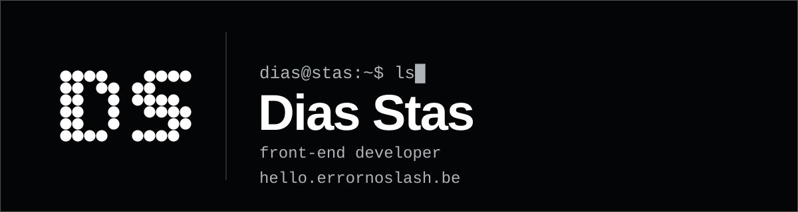

<p align="center">
  
</p>

My portfolio, live at [hello.errornoslash.be](https://hello.errornoslash.be). Rebuilt in the same style as my [contact page](https://contact.errornoslash.be): one big grid of lines, two fonts, black and white. Vanilla HTML, CSS and JavaScript — no frameworks, no build step.

## Features

- 🧱 Brutalist sheet layout — every part of the page is a bordered row, with a sticky nav row on top
- 📜 One page of full screens — you land on the intro, scroll on to the projects, the about screen and finally contact. Big screens gently snap to each one
- 🚪 Landing screen — typed intro, the donut and three "doors" (projecten, over, contact), with a status bar underneath
- 💻 Nav that follows you — the prompt types the command of the screen you are on (`./portfolio`, `ls ./projecten`, `cat over.txt`), that pill lights up and a line under the nav fills while you scroll
- 🗂️ Project browser — point at (or tab to) a project and a preview with its stack and features appears next to the list
- 📐 Tall screens get more, not emptier — the big title at the top with a field of dots below it that waves, lights up around your mouse and ripples where you click, working as an LED sign in the middle that spells words, scrolls the long ones and shows whatever you type, the full project story with screenshot and links in the preview, and the socials as big link rows on the over screen
- ✉️ Contact screen — a giant `ZEG HALLO` mail link, a small mail composer (subject + message) that builds the `$ mail -s "…"` command as you type and opens your own mail app, a button that copies the address, and the socials as a big labelled row above the copyright bar
- 🎬 Everything animates in — rows, cells, tiles and links fade and rise in one after the other as they come into view, and it all replays on every load (also reloads and back / forward)
- 🔠 Huge title with sliced echoes, letters spread across the row (any word length fits), rising in one letter after the other when they scroll into view
- ⌨️ Typed hero line with a blinking terminal caret
- 🍩 Spinning ASCII donut rendered live in JavaScript (no images, no canvas) that tilts towards your mouse
- ⏱️ Uptime counter in the status bar — how long you have been on the page, like a terminal
- 🎨 Project rows with a circular clip-path fill on hover
- 👾 Possessed portrait — moving over the photo turns the cells under the pointer into flickering terminal symbols that fade back into the picture
- ✨ Profile card that lifts with a hard shadow on hover (or when pressed on a phone) while a spotlight follows the cursor or finger and the asterisk spins
- 📂 A page per project that fits one screen: the story and links, the numbered features and a visual of its own (a clickable map of the home page, the possessed SlashyOS screenshot, a markdown-to-page example for the blog)
- 📱 Mobile menu — a `menu` pill opens a terminal-style panel with every page and the socials as an icon row
- 🎞️ Clean page transition — a curtain wipes up between the pages
- ⏳ Quick terminal-style preloader with a progress bar
- ⌨️ Browser tab title types and deletes terminal commands, like a shell prompt
- 📱 Rotate notice — a phone turned sideways gets an animated "draai je telefoon rechtop" screen (pure CSS)
- 🚫 JavaScript-off page — visitors without JavaScript are sent to `noscript.html`, a single terminal-style window that keeps every link working
- 🔍 404 page in the same window style that shows the path you tried
- 🌗 Light and dark theme that follows the system
- 🖱️ Custom cursor (dot + trailing outline), disabled on touch devices
- ♿ Respects `prefers-reduced-motion` — no preloader, a still donut, no letter animation, the typed line appears at once
- 🔗 Link preview — Open Graph and Twitter tags with a 1200×630 image, so shared links show a card
- 📅 Footer year updates automatically via JavaScript
- 🖥️ Tested on 4K, 1440p and 1080p screens at every Windows scale from 25% to 200% — very wide windows scale the whole page up, very short ones tighten every screen so it still fits
- 📱 Tested on phones from 320px (iPhone SE) to 430px (Pro Max), Android sizes and iPads — the nav prompt shortens, cards grow with their text, and upright tablets stack the project pages
- 📱 Fully responsive

## Projects

| project          | page |
| ---------------- | ---- |
| personal-website | [pages/projects/personal-website.html](pages/projects/personal-website.html) |
| SlashyOS         | [pages/projects/slashyos.html](pages/projects/slashyos.html) |
| blog             | [pages/projects/blog.html](pages/projects/blog.html) |

## Structure

```
.
├── index.html          # the one page: landing, projects, over + mail screens
├── 404.html            # page not found (paths start at / so it works on any url)
├── noscript.html       # shown when JavaScript is turned off
├── pages/projects/     # one page per project
├── CNAME               # custom domain for GitHub Pages
├── robots.txt
├── sitemap.xml
├── favicon.ico         # tab icon (16, 32, 48)
├── assets/
│   ├── banner.svg      # banner at the top of this README
│   ├── og-image.svg    # source of the link preview image
│   └── homelab-logo.*  # artwork, not used on the site yet
├── images/
│   ├── pfp.jpg         # profile picture
│   ├── slashyos.jpg    # screenshot on the SlashyOS page
│   ├── favicon.svg     # tab icon (dot-matrix DS)
│   ├── apple-touch-icon.png
│   └── og-image.png    # link preview image (1200×630)
├── styles/
│   ├── normalize.css
│   ├── window.css      # the single window of noscript.html and 404.html
│   └── style.css       # colors, layout, transitions
└── scripts/
    ├── preloader.js    # preloader with progress bar
    ├── pageTransition.js # curtain wipe between the pages
    ├── cursor.js       # custom cursor
    ├── getYear.js      # dynamic footer year
    ├── tabTitle.js     # typing and deleting text in the browser tab
    ├── title.js        # spreads the big title letters and times their rise
    ├── reveal.js       # rows, tiles and links fade and rise in when they come into view, on every load
    ├── marquee.js      # endless scrolling text (every marquee on the page)
    ├── typedIntro.js   # typed line on the landing page
    ├── asciiDonut.js   # spinning ascii donut that follows the mouse
    ├── uptime.js       # uptime counter in the status bar
    ├── dotMatrix.js    # dot field / led sign under the title (only when it fits)
    ├── navOnScroll.js  # nav prompt, active pill and progress line while scrolling
    ├── projectPreview.js # preview next to the project list
    ├── copyMail.js     # copy button next to the mail address
    ├── mailComposer.js # mail composer on the contact screen
    ├── menu.js         # menu panel on phones
    ├── cardSpotlight.js # spotlight on the profile card
    ├── pictureSymbols.js # possessed pictures (portrait, slashyos screenshot): symbols flicker where you move
    └── notFound.js     # shows the missing path on the 404 page
```

## Run locally

No build step — just open `index.html`, or serve the folder (needed for the 404 page):

```bash
python3 -m http.server 8000
```

Then visit `http://localhost:8000`.

## Deploy

Served with GitHub Pages on a subdomain:

1. Push to the published branch
2. `CNAME` record at the DNS provider: `hello` → `errornoslash.github.io`
3. The `CNAME` file in this repo keeps the custom domain set — don't delete it

## Customize

- **Projects** — the `<a class="link-row">` blocks and their `<article class="preview">` in the `#projecten` screen of `index.html`, a page in `pages/projects/` (copy one of the others), and the count in the status bar
- **About / skills** — the `.about` block in the `#over` screen of `index.html`
- **Typed line** — the `data-text` on `#typed-line` in `index.html`
- **Status bar** — the `.status-item` blocks in `index.html`
- **Tab title** — the `tabCommands` list at the top of `scripts/tabTitle.js`
- **Donut speed / size** — the constants at the top of `scripts/asciiDonut.js`
- **Link preview** — edit the Open Graph tags in the `<head>` of every page; to change the image, edit `assets/og-image.svg` and export it as `images/og-image.png` (1200×630, PNG)
- **Profile picture** — replace `images/pfp.jpg`
- **Colors** — the CSS variables at the top of `styles/style.css` (the same palette as the contact page):
  ```css
  :root {
      --black: #040507;
      --grey: #AEB5B8;
      --border: #525252;
  }
  ```

## License

MIT. Icons are from [Phosphor Icons](https://phosphoricons.com) (MIT).

---

`©Dias Stas` · [Contact](https://contact.errornoslash.be) · [Blog](https://blog.errornoslash.be) · [GitHub](https://github.com/ErrorNoSlash) · [Mastodon](https://mastodon.social/@slashy)
